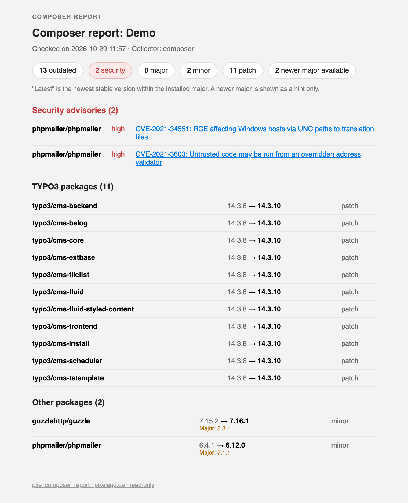

# pxe_composer_report

Read-only composer update report for a TYPO3 project: a backend module that
lists outdated packages and known security advisories, a scheduler task and a
CLI command that store the report on a schedule and optionally email it.

Supports TYPO3 13.4 LTS and 14 (PHP 8.2 to 8.4). English and German.


*(screenshot placeholder: backend module with security advisories, TYPO3 and other packages)*


*(screenshot placeholder: report email)*

## What it does

- Lists outdated **direct** dependencies of the project, TYPO3 packages first,
  sorted by impact (major / minor / patch). Abandoned packages are flagged.
- "Latest" means the newest stable version **within the installed major**; a
  newer major (e.g. 14.x while you run 13.x) is shown as a separate hint only.
  Packages that are current within their major but have a newer major are
  listed in their own "Newer major available" section, not counted as outdated.
- Lists security advisories (package, severity, CVE, link) above everything
  else, most severe first.
- Keeps a capped history of runs and shows a small trend of the outdated count.
- Optional HTML + plain-text email to a list of recipients, optionally only when
  there are findings; a test mail button in the module.
- Optional short plain-language summary via the Anthropic API (off by default,
  see *Privacy*).
- Shows clear messages instead of a blank page when something is wrong: not a
  composer installation, `composer.lock` missing, `proc_open()` disabled,
  composer binary not found, composer failed, Packagist unreachable.

The extension never changes the project. It only ever runs `composer outdated`
(twice: plain and `--minor-only`) and `composer audit` with fixed argument lists
(enforced by a unit test), or reads `composer.lock` and `composer.json`.

## Requirements

- TYPO3 13.4 LTS or 14 with `typo3/cms-scheduler`, PHP 8.2 or newer
- Composer-based installation (`composer.json` and `composer.lock` in the
  project root; classic installations are reported as unsupported)
- For the `composer` collector: the `composer` binary reachable by the PHP
  process (`composerBinary` setting) and `proc_open()` enabled. Otherwise the
  Packagist collector is used.

## Installation

```bash
composer require pixelegg/pxe-composer-report
vendor/bin/typo3 extension:setup
```

`extension:setup` creates the table `tx_pxecomposerreport_domain_model_run`
and writes the default settings.

## Configuration

*Admin Tools > Settings > Extension Configuration > pxe_composer_report*

| Setting | Default | Meaning |
|---|---|---|
| `collectorMode` | `auto` | `composer` runs the composer CLI, `packagist` asks the Packagist API, `auto` uses composer when `proc_open()` and the binary are available and falls back to Packagist (with a notice in the module) |
| `composerBinary` | `composer` | `composer` (searched in the `PATH` of the PHP process) or a full path such as `/usr/local/bin/composer` or `/opt/composer.phar` (`.phar` is run with the PHP CLI binary) |
| `projectLabel` | site name | Project name shown in the module and in the email |
| `keepRuns` | `50` | Number of stored runs; older runs are deleted after each run. `0` keeps everything |
| `resolveLatestViaPackagist` | on | Off: the extension itself never contacts packagist.org. The composer collector works without any lookup of its own; the Packagist collector then stops with a clear error |
| `privateVendors` | – | Comma-separated vendor prefixes or full package names, e.g. `acme, mycorp/intranet`. Never sent to Packagist, the advisories API or the AI summary; listed as "private, not checked" when the Packagist collector is used |
| `emailEnabled` | off | Send the report by email after each scheduled or CLI run |
| `emailRecipients` | – | Comma-separated recipient addresses |
| `emailOnlyOnFindings` | on | Only send when something is outdated or an advisory exists |
| `emailLanguage` | `en` | `en` or `de`; language of the email and of the AI summary |
| `aiEnabled` | off | Generate a short summary with the Anthropic API |
| `anthropicApiKey` | – | API key, required for the summary; stored in the TYPO3 system configuration |
| `anthropicModel` | `claude-haiku-5-5` | Model id for the summary; `claude-sonnet-5-5` or `claude-opus-5-5` for a more capable (and more expensive) one |

The sender address is TYPO3's system mail address
(`$GLOBALS['TYPO3_CONF_VARS']['MAIL']['defaultMailFromAddress']`).

Under php-fpm the `HOME` variable is often unset; composer then refuses to run.
The extension sets `COMPOSER_HOME` to `var/pxe_composer_report/composer-home`
in that case, so caches land in a writable place. Under cron the environment of
the cron user is used as is.

## Usage

### Backend module

*Admin Tools > Composer Report* (the group is called *Administration* in
TYPO3 14), administrators only. *Refresh now* runs a report immediately (this
can take a minute, composer talks to the repositories). *Send test mail* sends
the current report to one address or to the configured recipients. Both are
POST requests with a CSRF token.

### Scheduler

Add the task *Composer update report (read-only)*, e.g. weekly. A failed run
is stored with status "error" and marks the task execution as failed, so it
shows up in the scheduler module.

### CLI

```bash
vendor/bin/typo3 pxe:composer-report:run           # run and print a summary
vendor/bin/typo3 pxe:composer-report:run --mail    # also email the configured recipients
vendor/bin/typo3 pxe:composer-report:run --json    # print the stored report as JSON
```

Exit codes: `0` no security advisories, `1` security advisories found, `2` the
run failed (details on stderr and in the stored run). Suitable for cron and CI,
e.g. `... || notify-team`.

### Run history

Every run is stored in `tx_pxecomposerreport_domain_model_run` (report as JSON,
counts, collector, error). Only the newest `keepRuns` rows are kept.

## Privacy and external connections

Depending on the configuration, the following data leaves the server. Nothing
else is sent, and the extension does not read `auth.json` or any credentials.

| When | Target | Data sent |
|---|---|---|
| `composer` collector | every repository configured in the project's `composer.json` (Packagist and any private registries) | whatever composer itself sends for `composer outdated` and `composer audit`, using the project's own composer configuration and credentials. Note that `composer audit` sends the names of **all installed packages** to the Packagist advisories API (composer behaviour; see composer's `audit.ignore` / repository settings to restrict it). The extension itself makes no request in this mode |
| `packagist` collector | `https://repo.packagist.org/p2/<vendor>/<package>.json` | one GET per direct dependency that is not in `privateVendors`; the package name is part of the URL |
| `packagist` collector | `https://packagist.org/api/security-advisories/` | names of all direct dependencies that are not in `privateVendors` |
| any row without a within-major version (defensive fallback; does not happen with the shipped collectors) and `resolveLatestViaPackagist` on | `https://repo.packagist.org/p2/<vendor>/<package>.json` | the package name, unless in `privateVendors` |
| `aiEnabled` on | `https://api.anthropic.com/v1/messages` | package counts; for each security advisory the package name, severity, CVE and title; for each outdated TYPO3 package the name, installed version, latest version, next major and impact. Packages in `privateVendors` are removed first. No host names, paths, descriptions, links or user data. The model id and the API key go in the request as well |
| `emailEnabled` on / test mail | the TYPO3 mail transport | the complete report, to the configured recipients |

`resolveLatestViaPackagist = 0` guarantees that the extension itself never
opens a connection to packagist.org. `privateVendors` guarantees that the
listed packages never appear in any request made by the extension itself. All
requests expose the server's IP address to the target.

## Optional integration

If the (separate) extension `pxe_hub` is installed, the report also appears as
a card in its overview module. Without it, nothing changes; the integration is
registered only when `pxe_hub` is present.

## Development

```bash
composer install
composer ci              # cs + stan + unit + functional
composer ci:cs           # php-cs-fixer (typo3/coding-standards), dry run
composer ci:cs:fix
composer ci:stan         # PHPStan level 8
composer ci:rector       # rector dry run (ssch/typo3-rector)
composer ci:test         # unit tests
composer ci:test:functional   # functional tests (SQLite; set typo3DatabaseDriver=pdo_sqlite)
```

The functional tests run the whole pipeline against a fake composer binary
(`Tests/Functional/Fixtures/composer/`); no test needs network access.

Releases: bump `version` in `ext_emconf.php`, add a `CHANGELOG.md` entry, push
a tag `vX.Y.Z`. The workflow `.github/workflows/publish-ter.yml` uploads the
tag to the TYPO3 Extension Repository with `typo3/tailor` (secret
`TYPO3_API_TOKEN`, scope `extension:write`).

## Changelog

See [CHANGELOG.md](CHANGELOG.md).

## License

GPL-2.0-or-later, see `LICENSE.txt`. Made by [pixelegg](https://www.pixelegg.de).
